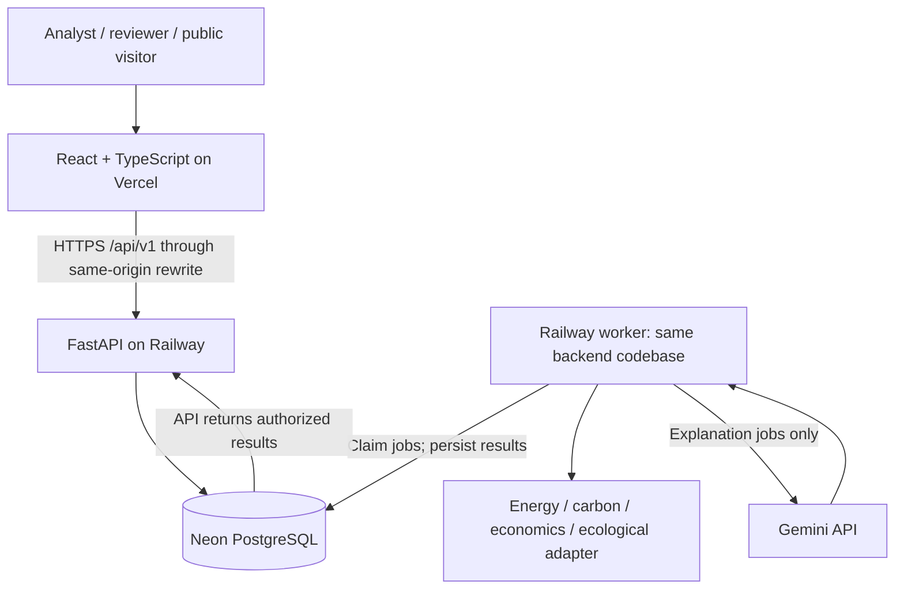
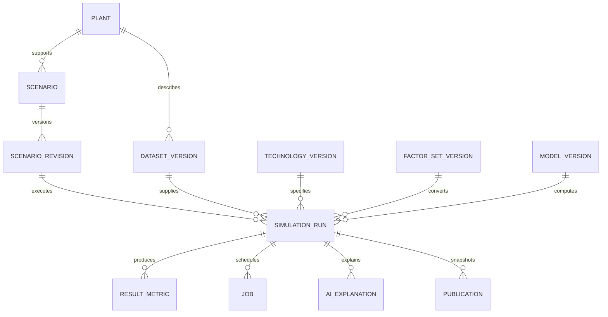

# Pax Virentia
## System Design & Architecture

**Version 0.1 | Review draft | 8 October 2026**

A proposed architecture for a Philippine water-treatment scenario simulator that compares operational energy demand, electricity-associated emissions, costs, and evidence-supported ecological indicators.

### Design recommendation

Use a **React + TypeScript + Vite frontend on Vercel**, a **Python FastAPI API and worker on Railway**, and **Neon PostgreSQL** for persistent data. Gemini provides explanations of stored simulation results. Python implements the numerical models and validation.

The backend is a modular monolith: one codebase with clear modules, deployed as an API process and a worker process. This matches the four-person, one-semester research scope without introducing independently deployed microservices.

### Document status

| Item | Basis |
| --- | --- |
| Research requirements | Supplied Chapter 1 & 2 PDF, 33 pages; page references use the PDF page numbers |
| User preferences | TypeScript frontend; Python FastAPI; Neon DB; Vercel and Railway; Gemini |
| Proposed additions | React, Vite, SQLAlchemy, Alembic, durable jobs, session authentication, scientific model registry |
| Scope assumption | Retain the water-treatment scope in the supplied chapters, pending user confirmation |
| Approval status | Proposed design; no production implementation or scientific validation claimed |

### Three decisions that control implementation

1. **Define the treatment technology.** Chapter 2 explicitly says that its Pax Silica policy reference does not establish a water-treatment method [S1, pp.26-27]. A technical specification and authoritative evidence are required before technology-specific predictions can be validated.
2. **Separate numerical prediction from generated explanation.** A Gemini integration does not establish the predictive accuracy of the energy or ecology models.
3. **Retain uncertainty.** If ecological observations or a defensible predictive model are missing, show an unavailable result with its reason. Do not fabricate a damage percentage or sustainability verdict.

### Reading guide

Sections 1-4 establish scope and software structure. Sections 5-9 specify data, computation, AI, and persistence. Sections 10-14 define interfaces, security, deployment, testing, and delivery. A glossary is supplied separately as CONTEXT.md.

<!-- pagebreak -->

## 1. Scope, users & requirements

The research describes an **offline, digital-twin-inspired scenario model** for one representative Philippine water-treatment plant. It has no live plant synchronization. Retain “Digital Twin Model” when mapping to the thesis, while making this operational limitation visible [S1, pp.8-11].

### Requirement traceability

| ID | Requirement from the chapters | Design response | Source |
| --- | --- | --- | --- |
| FR-01 | Prepare heterogeneous source data | Validated imports, units, provenance, quality report | pp.5-6 |
| FR-02 | Model energy across operating scenarios | Versioned Python energy module | pp.8,10 |
| FR-03 | Calculate Philippine grid emissions | Curated region/year-compatible factor sets | pp.6,8,10 |
| FR-04 | Present indicative ecosystem effects | Evidence-gated ecological model interface | pp.7-8,10 |
| FR-05 | Compare costs and savings | Baseline-versus-intervention cost module | pp.7-8,10 |
| FR-06 | Provide dashboard and comparisons | Scenario builder, result views, comparisons and exports | pp.7-10 |
| FR-07 | Support public understanding | Explicitly published, simplified result snapshots | pp.9-11 |
| FR-08 | Evaluate and document the platform | Test evidence, research evaluation, user guide | pp.8-11,25-26 |

### Proposed application roles

| Role | Allowed actions |
| --- | --- |
| Analyst / plant operator | Prepare data, create scenarios, launch runs, compare results, export authorized reports |
| Reviewer | Read workspace evidence and results; approve or reject a public snapshot |
| Administrator | Manage workspace users, curated factors, approved models, retention, and publication withdrawal |
| Public visitor | Read explicitly published summaries; no access to drafts, raw files, or internal notes |

These are application permissions, not claims of government authority. DENR, DOE, LWU and plant-operator stakeholders can be mapped to roles during onboarding. One research workspace is sufficient for the MVP; multi-organization tenancy is excluded.

### Explicit exclusions

No IoT, sensors, SCADA, live process control, certified environmental impact assessment, complete life-cycle assessment, other treatment technologies, multilingual UI, or validated multi-plant generalization. English UI, sample datasets and a single representative plant remain the study boundaries [S1, pp.10-11,22].

<!-- pagebreak -->

## 2. Architecture & stack decisions

| Layer | Proposed selection | Why it fits |
| --- | --- | --- |
| Browser application | React, TypeScript, Vite; React Router; TanStack Query; ECharts | Dashboard-focused UI, typed contracts, server-state caching and accessible chart alternatives |
| API | Python FastAPI, Pydantic | Input schemas, OpenAPI contracts, authorization and orchestration |
| Scientific services | NumPy, pandas; scikit-learn when labeled data is adequate | Auditable calculations and a separate, testable ML pipeline |
| Persistence | Neon PostgreSQL; SQLAlchemy; Alembic | Relational integrity, versioned snapshots, transactions and schema migrations |
| Background execution | Railway worker using a PostgreSQL job table | Durable execution independent of an HTTP request; no Redis required for the initial scale |
| Explanation | Gemini API through google-genai | Structured narrative grounded in approved result facts |
| Hosting | Vercel frontend; Railway API + worker | Keeps the user's preferred hosting split |

TypeScript is the frontend language; React and Vite supply the missing application framework and build tooling. The specific dependencies above are recommendations, not requirements from the chapters. Pin compatible versions when implementation begins [S2-S7].



### Alternatives considered

**Recommended: modular monolith + worker.** One backend release and shared typed domain objects; durable jobs add one service but protect simulations from request timeouts.

**Synchronous FastAPI only.** Fewer moving parts; acceptable for tiny deterministic prototypes, but restarts and long calculations make the request lifecycle a poor owner for durable runs.

**Microservices and a separate broker.** Useful when independently scaling teams and workloads; unnecessary operational overhead for this semester's scope. A cited microservices study is a reference, not a requirement to reproduce that architecture [S1, pp.11,17].

<!-- pagebreak -->

## 3. Simulation lifecycle & data flow

1. An analyst registers sources and imports plant observations. Validation produces an accepted, versioned dataset and a quality report; rejected rows remain traceable.
2. The analyst creates a baseline and an intervention scenario with an explicit service volume, period, technology specification, grid factor and cost assumptions.
3. FastAPI checks authorization, ranges, units, compatibility and required evidence. In one transaction it freezes the scenario revision and creates a run plus a durable job.
4. The API returns **202 Accepted** with the run ID and status URL. The frontend polls the API; it does not wait on one long request.
5. A worker claims the job, computes all applicable numerical modules, and commits immutable outputs with their provenance and warnings.
6. The analyst can immediately inspect results. A separate explanation job can send the approved result envelope to Gemini. AI failure never removes numerical outputs.
7. A reviewer may publish an explicitly selected, redacted snapshot for the public view. Publication does not imply regulatory approval.

```mermaid
sequenceDiagram
  participant UI as Browser
  participant API as FastAPI
  participant DB as Neon
  participant W as Worker
  participant AI as Gemini
  UI->>API: POST run + idempotency key
  API->>DB: Transaction: snapshot + run + job
  API-->>UI: 202 + run ID
  W->>DB: Claim job with lease
  W->>W: Validate snapshot; compute numerical results
  W->>DB: Commit results + success atomically
  UI->>API: GET run status/results
  API-->>UI: Results and evidence labels
  UI->>API: Request explanation
  API->>DB: Queue explanation job
  W->>AI: Approved facts + allowed source IDs
  AI-->>W: Structured narrative
  W->>DB: Store validated narrative or failure reason
```

### State and concurrency rules

Run states: **queued -> running -> succeeded / failed / cancelled**. A cancellation request is stored separately until the worker acknowledges it. Retrying a failed job creates a new attempt, not a rewritten historical result. Exhausted infrastructure retries mark the run failed.

Freeze dataset, technology, factor and algorithm versions at submission. Editing a scenario creates a new revision. Compare runs only when service volume, period, currency and emissions boundary are compatible; otherwise show explicit incompatibilities.

<!-- pagebreak -->

## 4. Backend modules & ownership

| Module | Responsibility and boundary |
| --- | --- |
| Identity and access | Verify sessions and workspace roles; enforce access on every private endpoint |
| Source catalog | Register data origin, license, period, region, units, approval and immutable source versions |
| Data preparation | Parse bounded CSV uploads; validate and normalize rows; store raw-to-clean lineage |
| Plant and technology | Store the representative plant and versioned treatment specifications with evidence status |
| Scenarios | Manage revisions, paired baselines, parameter bounds and comparison compatibility |
| Run orchestration | Snapshot inputs, enforce quotas, queue/cancel work, expose status and idempotency |
| Energy simulation | Compute electricity demand; accept validated ML artifacts only through a defined adapter |
| Carbon accounting | Apply compatible grid factors to energy; track emissions boundary and factor coverage |
| Economic simulation | Calculate period costs, savings and optional payback from explicit assumptions |
| Ecological assessment | Validate required evidence; run approved indicators or return not_estimable |
| Explanations and reports | Validate Gemini narratives; render exports from stored facts and citations |
| Review and publication | Create public snapshots, capture reviewer decisions and audit changes |

### Dependency direction

HTTP routes call application services. Application services call domain/calculation modules and repositories. Numerical functions receive typed, immutable inputs and return typed results; they do not query the database, call Gemini, or read mutable global settings. This makes the same model callable from a worker, a test, or an evaluation script.

### Proposed repository layout

```text
apps/web/                 React + TypeScript UI
backend/app/api/          Routes, schemas, authentication
backend/app/services/     Scenario, run, publication workflows
backend/app/domain/       Domain types and invariants
backend/app/calculations/ Energy, carbon, economics, ecology
backend/app/repositories/ SQLAlchemy persistence
backend/app/jobs/         Job claiming, leases, worker entrypoint
backend/app/integrations/ Gemini client and output validator
backend/alembic/          Ordered migrations
backend/tests/            Unit, integration and contract tests
research/                 Data dictionary, model cards, evaluation
docs/                     Architecture, setup guide and user manual
```

Do not put numerical formulas in chart components or API route handlers. Generate TypeScript API types from FastAPI's OpenAPI schema and check the generated contract in CI. The database schema remains a backend concern.

<!-- pagebreak -->

## 5. Data acquisition & input contracts

Data quality is a first-class output. Every imported value must remain attributable to a source record and a preprocessing version [S1, pp.6,26]. Automatic correction must never erase the original measurement.

| Dataset | Minimum fields and units | Evidence requirements |
| --- | --- | --- |
| Plant observations | period_start/end; volume_m3; electricity_kwh; pump_hours; equipment IDs; relevant process variables | Source, sampling interval, measurement method, missing-value flags |
| Technology specification | equipment power in kW; operating limits; capacity in m3/h; documented load curves; capex_php | Version, technical reference, validity range; unverified until reviewed |
| Grid factors | grid_region; reporting_year; gas_basis; kg_per_kwh; factor_method | Exact publication/table, boundary, release/version; DOE or suitable IEA source |
| Cost assumptions | tariff_php_per_kwh; chemical dose mg/L and price PHP/kg; labor and maintenance PHP/period | Currency, price date, inclusions and source; no live tariff assumption |
| Environmental observations | defined indicator target; unit; location; period; exposure and habitat covariates | Target-specific measurement protocol and sufficient paired outcomes |

### Import workflow

Upload CSV -> inspect schema -> map columns -> normalize units and dates -> report errors, duplicates and outliers -> analyst resolves issues -> approve immutable dataset version. Initially limit each file to **10 MB and 50,000 rows**, proposed operational bounds that must be load-tested.

Store the exact original CSV bytes and checksum in Neon for these small academic datasets, with bounded retention and access controls. Use normalized observation tables for calculation. If file sizes grow materially, move original files and large reports to dedicated object storage through a storage adapter; do not rely on Railway's ephemeral filesystem [S3].

### Validation policy

- Require positive service volume for per-volume comparisons, positive flow capacity, nonnegative energy and dose, bounded duty hours, and physically consistent treatment capacity. Validate against the selected specification's supported ranges.
- Reject unknown units, invalid dates, overlapping duplicate records, nonfinite numbers and unsupported source encodings. Convert known units explicitly; preserve both raw and canonical values.
- Do not silently delete outliers. Record the detection rule and the analyst's accept/exclude decision. Critical missing values block a run; any permitted imputation is versioned and labeled.
- Distinguish **measured, externally sourced, assumed and synthetic** data. Synthetic input can verify software behavior, but cannot establish real-world accuracy.
- Use plant-local reporting periods in Asia/Manila and UTC instants for audit events. Preserve the source time basis. Convert totals and rates before aggregating time series.

### Stable run envelope

Each run freezes its scenario revision, dataset checksum, technology version, factor-set version, model version, cost assumptions, comparison period, unit system, random seed when applicable, and code release identifier. Source references are stored with the snapshot, not merely linked to mutable catalog rows.

<!-- pagebreak -->

## 6. Numerical model specification

These equations are a **proposed baseline**, not a validated Pax Silica process model. A domain reviewer must approve equipment behavior, treatment constraints and technical inputs before scientific claims are made.

### Energy and process feasibility

For equipment i during interval t:

```text
E_total_kWh = sum(P_i_kW * load_multiplier_i,t * hours_i,t)
energy_intensity = E_total_kWh / treated_volume_m3
```

Use a validated operating curve or documented load multiplier. A multiplier of 1 means stated steady input power, not an assumed efficiency gain. Flow rate and pump hours must satisfy the required treated volume and equipment capacity. Mixing intensity maps to power only through an explicit specification. Chemical dose affects chemical cost; any effect on electricity or treatment quality needs evidence.

One energy engine is active per run: deterministic or approved ML. Do not add both predictions together. Never extrapolate outside supported operating ranges without a visible out-of-domain status. If volume is zero, per-volume metrics are unavailable. A scenario that cannot meet the required service volume is not a valid cost-saving alternative.

### Electricity-associated emissions

```text
GHG_kgCO2e = sum(E_t_kWh * grid_factor_t_kgCO2e_per_kWh)
delta_GHG = intervention_GHG - baseline_GHG
```

A factor reported as CO2-only produces kg CO2, not automatically kg CO2e. Match grid region, year/period and factor methodology; a generation-mix factor is not silently substituted for another accounting boundary. No valid factor means no emissions result. This module excludes embodied, direct process and transport emissions unless separately added and documented. It is not a full plant footprint or LCA.

### Period costs and comparison

```text
chemical_kg = dose_mg_per_L * treated_volume_m3 / 1000
OPEX = electricity_kWh * tariff_PHP_per_kWh
     + chemical_kg * chemical_price_PHP_per_kg
     + labor_PHP + maintenance_PHP + other_nonenergy_PHP
net_savings = baseline_OPEX - intervention_OPEX
```

Compare the same volume, period, currency and included cost categories. Keep capex separate from period OPEX. Do not count electricity again inside a supplied all-inclusive operating-cost value. Optional simple payback is incremental capex divided by positive annual net savings; show “not applicable” for nonpositive savings or a nonpositive incremental investment. Discounted finance metrics are deferred.

### Illustrative arithmetic test, not a plant estimate

With invented test inputs of 100 kWh, 0.5 kg CO2e/kWh and PHP 10/kWh, expected outputs are 50 kg CO2e and PHP 1,000 electricity cost. This fixture verifies arithmetic only; none of its constants is a recommended Philippine factor or tariff.

<!-- pagebreak -->

## 7. ML, ecology & scientific validity

### Energy prediction research track

The title promises machine learning, but the chapters do not supply a training dataset or selected algorithm [S1, pp.1,8,19]. Implement a deterministic baseline first, then compare a simple regularized regression and a tree-based regressor using observed energy as the target. Deep sequence models are a later option only when the amount and temporal structure of data justify them.

Split chronological observations into training, validation and a locked final test period **before** imputation, scaling, feature selection or augmentation. Fit preprocessing on training data only; construct lagged features without future information. Evaluate MAE, RMSE and, where meaningful, R-squared against a naive baseline. Use MAPE only where actual values are safely nonzero. Report sample count, dates, missingness, target units and the limits of single-plant evaluation.

Register a model only with its dataset hash, feature schema, preprocessing artifact, code version, evaluation results, supported ranges and approval. Scientific acceptance thresholds must be chosen with the adviser from domain needs; literature-reported accuracy is not a target or achieved result for Pax Virentia.

### Ecological assessment gate

Electricity-associated carbon emissions alone do not establish damage to nearby land or marine ecosystems. The chapters contain no validated local exposure-response relationship, thresholds or labeled target dataset [S1, pp.10-11,16,26].

An ecological model requires: a defined measurable target; appropriate spatial and temporal observations; exposure and habitat covariates; a defensible model or characterization method; and independent evaluation. Keep these requirements distinct from the grid emissions calculator.

Until the gate is met, return:

```json
{
  "status": "not_estimable",
  "value": null,
  "reason": "Validated ecological model or required inputs unavailable",
  "required_evidence": ["defined target", "paired observations", "validation"]
}
```

This is an honest product state, but also a **research scope gap**: FR-04 cannot be declared scientifically fulfilled while its model is unavailable. The team must obtain evidence or formally revise the thesis scope. An illustrative proxy may be used only if explicitly approved and labeled as such, never as measured environmental damage.

### Uncertainty and treatment claims

Sensitivity tests vary documented assumptions one at a time or through a defined sampling scheme. Scenario ranges are not statistical confidence intervals. Use probabilistic intervals only when a statistical method and its assumptions support them. Do not label a scenario “sustainable” based on one improved metric, or claim operation “without ecological trade-offs.”

The treatment specification is **unverified** until the Pax Silica naming and technical-source issue is resolved [S1, pp.26-27]. Software development can proceed against clearly marked illustrative fixtures; validated technology-specific conclusions cannot.

<!-- pagebreak -->

## 8. Gemini integration & explanation controls

Gemini is an optional explanation service over stored, authorized results. Its role is to summarize differences, explain assumptions, identify missing evidence and draft report narrative. It does not calculate authoritative metrics, choose unsupported ecological thresholds, or approve treatment adoption.

### Request and response contract

| Direction | Allowed content |
| --- | --- |
| Backend to Gemini | Run ID, selected metric facts, units, baseline differences, evidence labels, limitations and allowed source IDs |
| Gemini to backend | Summary; claim objects referencing fact IDs; caveats; comparison observations; suggested questions; source IDs |
| Backend validation | Pydantic schema, allowed IDs, absence of unsupported values, required limitations, length and content bounds |
| Browser display | Label “AI-generated explanation”; render approved fact values directly from stored results alongside narrative |

Prefer claim objects that reference numerical facts over asking the model to reproduce numbers in prose. If narrative introduces a number, source, or claim the validator cannot reconcile with the result envelope, discard that narrative and show a deterministic template. Structured output constrains shape; it does not prove factual correctness [S6].

### Operational policy

- Use the Python **google-genai** SDK and a configurable GEMINI_MODEL identifier. Select a supported stable model through the deployment account and evaluation; pin the chosen ID and record the returned model metadata. Do not assume the model shown in an agent CLI is available through the production API.
- Keep the API key in Railway's secret environment, never in VITE variables or browser storage. Configure the application's own Google project, credentials and quota; a personal Google AI Pro coding workflow is not the application's credential mechanism [S7].
- Store model identifier, prompt/schema versions, input hash, validated output, timestamps and failure status. Cache by result snapshot + prompt version + model ID. Exact narrative reproduction is not promised.
- Queue explanations separately. Apply request timeouts, bounded exponential retries for transient failures, per-user limits, a maximum output budget and a daily project usage cap. On outage or quota exhaustion, preserve the numerical dashboard and display a template summary.
- Send the minimum relevant facts. Exclude private personal identifiers and unrestricted raw datasets. Review provider terms, data handling and project settings before uploading confidential plant records.

### Prompt-injection boundary

Treat CSV cells, uploaded descriptions and user questions as untrusted data. They cannot override model rules, invoke tools, change database records, or authorize a new run. The explanation service has no shell, SQL, browsing or file-execution tools. External citations must resolve to the source IDs already approved by the backend.

### Product AI versus development agents

Gemini Planner, Codex Senior and Muse Junior are development tools used to build the project. They are not deployed services, and their conversations are not a production database or an application requirement.

<!-- pagebreak -->

## 9. Domain model & relationships

The glossary in CONTEXT.md fixes domain language. A **scenario** is a proposed operating configuration; a **scenario revision** is a frozen version of that configuration; a **run** is one execution against specific evidence and algorithms. Editing a scenario never changes an old run.



The diagram shows primary scientific relationships. Identity, source lineage, audit and job-attempt tables are detailed below. A comparison references two or more immutable runs; it does not create a third altered set of results.

### Invariants

- Every private record belongs to the single research workspace and is accessed under a verified role. A later multi-workspace extension must add enforced ownership keys, not just a frontend filter.
- Published factors, dataset versions, treatment specifications and model artifacts are immutable. Corrections create a new version; deprecation prevents future selection while preserving old runs.
- Run snapshots retain exact values, source references and executable-model provenance even if a catalog entry is later deprecated. Historical results are not recomputed when a factor changes.
- Missing ecological evidence yields null plus a status and reason. “Zero” remains a measured or computed quantity, never a substitute for unavailable data.
- Only compatible runs may produce a percent-difference chart. If the baseline denominator is zero, show the absolute difference and mark the percent change undefined.
- A publication is a reviewed, redacted snapshot with a version, reviewer and publication time. Later edits to a private scenario cannot silently change public content.

### Deletion policy

Archive scenarios used by runs. Reject deletion of referenced evidence or retain it under the approved research retention policy. Revoke public access immediately when a publication is withdrawn; retain the internal audit record. Define actual retention periods and source licenses before accepting confidential data.

<!-- pagebreak -->

## 10. PostgreSQL persistence design

Use UUID primary keys, explicit foreign keys, UTC timestamps and checked status values. Use typed columns for searchable fields and exact NUMERIC values for currency/factors. JSONB holds versioned variable parameter sets and immutable snapshots; it does not replace core relational constraints.

| Table / aggregate | Principal columns and constraints |
| --- | --- |
| users / sessions | email UNIQUE, password_hash, role, active; token_hash UNIQUE, user_id, expires_at, revoked_at |
| plants | name, grid_region, reporting_timezone, capacity_m3_per_hour, metadata; one representative plant in MVP |
| sources / source_versions | title, URI, license, retrieved_at; version, publication_period, checksum, evidence_status |
| dataset_versions / observations | plant_id, source_version_id, content_hash, schema_version, quality_report, original_csv; canonical period values |
| technology_versions | name, version, parameter_schema, supported_ranges, technical_source_version_id, evidence_status |
| factor_set_versions / factor_entries | version, region, period, gas_basis, method, unit, value, source_version_id; reject ambiguous overlapping selection |
| model_versions | module, algorithm, artifact_checksum, feature_schema, training_data_hash, metrics, supported_ranges, approval |
| scenarios / scenario_revisions | plant_id, name; revision_no, parameters, baseline_revision_id, created_by; UNIQUE(scenario_id, revision_no) |
| simulation_runs | revision_id, frozen_inputs, snapshot_hash, code_version, status, submitted_by, started_at, ended_at; evidence-version FKs |
| result_metrics | run_id, metric_key, interval_key, value, unit, status, uncertainty, source_refs; UNIQUE(run_id, metric_key, interval_key) |
| jobs / job_attempts | run_id, kind, status, available_at, lease_token, lease_until, cancel_requested; attempt_no, errors and timing |
| ai_explanations | run_id, model_id, prompt_version, input_hash, validated_output, validation_status, usage_metadata |
| publications / audit_events | immutable redacted_payload, reviewer, status; actor, action, entity_id, timestamp, change_summary |

### Database constraints and indexes

Keep interval_key non-null, using a canonical “total” value for aggregate metrics. This makes the metric uniqueness constraint effective. Enforce required units, nonnegative applicable values, valid period order and version references at the database and API boundaries.

Index jobs by (status, available_at), runs by (scenario_revision_id, created_at), observations by (dataset_version_id, period_start), and publications by (status, published_at). Paginate lists; batch metric retrieval to avoid one query per chart point. Separate private and public response schemas.

### Durable worker protocol

Claim ready jobs with a short transaction and row locks using SKIP LOCKED [S9]. Assign an owner token and expiry, commit, then compute outside the transaction. Renew the lease during long work. Commit results and terminal status atomically only if the owner token still matches. Expired attempts may be retried with backoff and a bounded attempt count. Check cancellation before publishing.

This is **at-least-once execution**. Idempotency keys, fenced writes and uniqueness constraints prevent duplicated published results; they do not guarantee that computation runs only once. Keep connection pools bounded and use Neon's pooled URL for services, a direct URL for migrations [S4].

<!-- pagebreak -->

## 11. HTTP API contracts & errors

Expose a versioned /api/v1 API and generate its OpenAPI specification through FastAPI. All identifiers are opaque. Authenticate private endpoints, enforce the role matrix server-side, validate content types, and paginate collection responses.

| Method and endpoint | Purpose and permission |
| --- | --- |
| POST /auth/login; POST /auth/logout; GET /auth/me | Establish, revoke or inspect a session; login is rate-limited |
| POST /datasets; GET /datasets/{id}/quality | Analyst uploads a bounded CSV and reads its validation report |
| GET /catalogs; POST /catalogs/versions | Read approved plant/factor/model choices; administrator publishes curated versions |
| POST /scenarios; POST /scenarios/{id}/revisions | Analyst creates or revises a scenario; does not mutate a historical revision |
| POST /runs | Analyst submits a frozen revision; requires Idempotency-Key; returns 202 |
| GET /runs/{id}; GET /runs/{id}/results | Read authorized lifecycle status or immutable metrics |
| POST /runs/{id}/cancel | Analyst requests cancellation; ownership and state checked |
| POST /comparisons | Compare compatible completed run IDs; returns deltas and mismatches |
| POST /runs/{id}/explanations; GET /explanations/{id} | Queue and retrieve a validated narrative; no direct provider call from browser |
| POST /reports; GET /reports/{job_id} | Queue an export; download or regenerate from immutable run data |
| POST /publications; POST /publications/{id}/withdraw | Reviewer approves a redacted snapshot or removes public access |
| GET /publications/{public_id} | Public visitors receive only the approved public schema |

### Run submission example

```json
{
  "scenario_revision_id": "<uuid>",
  "requested_modules": ["energy", "carbon", "economics", "ecology"]
}
```

The revision already contains selected versions and assumptions; the server resolves and freezes them. Do not let a browser submit trusted calculation results. Bind an idempotency key to user, endpoint and request hash; reuse with a different payload returns 409. Same key and payload returns the original run reference.

### Error and result semantics

Use 401 for no valid session, 403 for insufficient permission, 404 for unavailable resources, 409 for state/version conflict, 422 for invalid input or incompatible scientific assumptions, and 429 for quota limits. Return a stable error code, safe message, field errors and request ID. Never expose SQL, credentials or raw provider traces.

HTTP success does not mean every scientific metric exists. A completed run may contain an ecological metric with status not_estimable and null value; the UI must display that status. Unexpected code failures mark the affected run failed, not scientifically unavailable. Reports distinguish rejected inputs, computation failure and insufficient evidence.

<!-- pagebreak -->

## 12. UX, authorization & security

### Main user journeys

**Analyst:** sign in -> inspect data quality -> choose baseline -> configure intervention -> resolve validation issues -> run -> compare -> export. Show units next to inputs, explain supported ranges and distinguish an assumption from a measured value.

**Reviewer:** open a completed run -> inspect evidence, methodology and limitations -> preview the public schema -> publish or reject with a reason. **Public visitor:** read the approved summary, source dates and limitations without account access to internal data.

Charts require text/table equivalents, keyboard navigation, visible focus, sufficient contrast and labels beyond color. Display cost, energy and emissions side by side. Do not collapse them into an unexplained “green score.” The ecological card must show “not estimable” when evidence is absent. Long jobs show status and cancellation rather than a frozen screen.

### Proposed authentication

For the single-workspace MVP, use administrator-provisioned accounts, Argon2id password hashing and opaque random server-side sessions. Store only a cryptographic hash of each session token, plus expiry and revocation state. Rotate on login and privilege changes; revoke on logout and account disablement. Do not implement public registration, federated SSO or email delivery in the MVP. FastAPI's security documentation supports modern password hashing; the opaque-session design here is a project choice [S8].

Serve browser API calls through Vercel's same-origin /api rewrite. Use a __Host-pv_session cookie with Secure, HttpOnly, SameSite=Lax, Path=/ and no Domain attribute. Enforce a CSRF token and exact approved Origin on state-changing browser requests, including login. Reject untrusted or missing browser origins where appropriate. Test these rules through the deployed proxy.

### Trust boundaries

| Boundary | Required control |
| --- | --- |
| Browser -> API | Server-side role checks, schema validation, bounded requests, CSRF and session checks |
| Upload -> parser | File/row limits; reject unexpected formats; no executable deserialization; parameterized database access |
| API/worker -> Neon | TLS, least-privilege application roles, separate migration credential, bounded connection pool |
| Worker -> Gemini | Secret key, approved facts only, timeout/quota limits, output validation |
| Private -> public | Explicit reviewed snapshot, redaction, withdrawal, audit record |

Protect the direct Railway API hostname with the same checks; a rewrite is routing, not authorization. Escape exported CSV cells that begin with spreadsheet formula characters. Logs omit passwords, tokens, connection strings and raw confidential uploads. Load only approved model artifacts produced by the team's trusted pipeline, never arbitrary user-supplied pickle files.

<!-- pagebreak -->

## 13. Deployment & operational design

### Environment topology

Use separate development, staging and production configurations. Local development runs Vite, FastAPI, the worker and a development database. Vercel previews use staging data and credentials. Production uses a dedicated Neon database/branch, Railway services and a restricted Gemini project key.

| Component | Runtime configuration |
| --- | --- |
| Vercel frontend | Build apps/web; publish dist; /api/:path* -> fixed Railway origin; SPA fallback after API rewrite |
| Railway API | FastAPI container, listening on supplied PORT; liveness and readiness routes |
| Railway worker | Same backend image, separate worker command; no public endpoint; lease-based jobs |
| Neon | Pooled DATABASE_URL for services; direct MIGRATION_DATABASE_URL for release migrations |
| Gemini | Server-only GEMINI_API_KEY and selected GEMINI_MODEL; explicit project usage limits |

Vercel supports external rewrites [S2]. Preserve the /api/v1 prefix consistently and disable API rewrite caching. Return Cache-Control: private, no-store for authentication and private responses. The proxy design avoids production cross-origin browser cookies; development should use a Vite proxy. If direct cross-origin requests are introduced, allow exact origins only, with explicitly configured credentials [S5].

### Release procedure

Run checks -> build immutable backend image -> apply reviewed Alembic migrations once using the direct connection -> deploy API and compatible worker -> deploy frontend -> run login, scenario and publication smoke tests. Use backward-compatible expand/contract migrations. Drain or retry in-flight jobs safely; do not overwrite pinned model artifacts while old jobs still need them.

Record the application release and scientific model versions with every run. Rollback means deploying the previous compatible image; it does not automatically undo a destructive database migration. Keep irreversible schema changes out of early releases.

### Reliability, observability and recovery

Log structured request/run/job IDs, duration, result status and sanitized error codes. Track queue depth, oldest job age, failed attempts, model validation failures, DB pool saturation and Gemini usage. Alert the team on sustained failures or exhausted quotas.

Use automatic platform backups where configured and scheduled encrypted database exports appropriate to the chosen plan. Proposed targets: recovery point within 24 hours and recovery within one working day; prove them with a staging restore exercise. Export schema, reference data, model registry and result lineage together.

Neon job polling can keep compute awake [S10]. Document that cost/latency tradeoff and cap worker concurrency. Hosting quotas, region options and prices must be verified when selecting plans. Keep persistent state out of Railway container filesystems [S3]. App secrets and production data must not enter Git or preview bundles.

<!-- pagebreak -->

## 14. Verification & research evaluation

All targets here are proposed acceptance criteria. They are not measured performance results. Separate software correctness, scientific validity and usability evidence in the evaluation chapter.

| Test area | Acceptance evidence |
| --- | --- |
| Numerical units | Hand-worked fixtures for kW-hours to kWh, mg/L to kg, kWh to emissions and cost; documented tolerances |
| Invariants | Identical baseline/intervention gives zero deltas; zero denominator handled; capacity violations blocked; no negative valid energy |
| Evidence | Missing or mismatched factor blocks emissions; absent ecological model returns null and reason; unverified treatment stays labeled |
| Reproducibility | Same immutable numerical snapshot and code/model versions reproduce results within specified floating-point tolerance |
| ML accuracy | Leakage-resistant holdout, naive-baseline comparison, MAE/RMSE and sample coverage; synthetic results labeled separately |
| AI explanations | Unsupported facts/citations rejected; invalid JSON and quota failures use templates; numerical results remain unchanged |
| API/security | Role matrix, CSRF, session expiry/logout, direct Railway access, upload limits, ID tampering and public/private separation |
| Job reliability | Kill worker before/after storage; retry expired lease; prove stale attempts cannot publish; cancellation and idempotency tests |
| UX/accessibility | Keyboard-complete core journey; table alternatives; readable missing-data states; stakeholder task completion and feedback |
| Deployment | Migration smoke test, proxy-cookie checks, public withdrawal, data restore and production-secret isolation |

### Proposed performance envelope

Start with 10 concurrent signed-in users, one numerical worker, one run active per user and a bounded queue. Target p95 below 1 second for warm non-upload CRUD/status requests and below 2 seconds for an accepted run submission. A reference numerical run of at most 365 daily intervals should finish within 30 seconds on the selected staging worker; measure before promising this. Model training and large parameter sweeps are offline research tasks.

Measure cold starts, database wake-up and queue wait separately. Poll at a moderate interval (for example, 2 seconds while a run is active with backoff when idle); stop polling on completion or a hidden page. This UX polling is separate from the worker's database poll cadence.

### Research evaluation protocol

Document the sample plant dataset, observation periods, target definitions, preprocessing, model splits, limitations and adviser-approved accuracy thresholds. Record stakeholder role and prior experience when collecting usability feedback; do not generalize a small convenience sample to every regulator or plant operator.

The chapters propose a framework such as ISO/IEC 25010 [S1, pp.10,25]. Select and cite the applicable edition in the research protocol, then map chosen quality characteristics to actual tests. This draft does not claim standards certification or reproduce normative standard text.

<!-- pagebreak -->

## 15. Delivery plan & review gates

### Build sequence for one semester

| Stage | Deliverable | Exit condition |
| --- | --- | --- |
| 1. Evidence and scope | Treatment definition, source register, data dictionary, prototype scenarios | Adviser resolves Pax Silica terminology; sample-data access and indicator targets agreed |
| 2. Application foundation | Repository, CI, migrations, authentication, source catalog | One user can sign in; access tests and deployment smoke test pass |
| 3. Numerical baseline | Dataset validation; energy, carbon and economic modules | Hand-worked fixtures and scenario compatibility tests pass |
| 4. Durable simulation | Snapshots, queue/worker, run lifecycle, comparison dashboard | Restart/retry tests pass; users can reproduce a stored run |
| 5. Research models | Energy ML comparison; evidence-gated ecological adapter | Holdout results documented or a formal scope revision records missing evidence |
| 6. Explanation and reporting | Gemini adapter, reviewed public snapshots, exports | Grounding, outage, authorization and publication tests pass |
| 7. Evaluation and handover | Usability study, recovery drill, implementation guide and manual | Results and limitations documented; reproducible release and setup guide |

### Development-agent responsibilities

Gemini Planner maintains requirements, architecture decisions and task dependencies. Codex Senior owns integration-sensitive work such as numerical interfaces, schema migrations, auth and worker behavior. Muse Junior can handle bounded UI pieces, fixtures and documentation against agreed contracts. Human reviewers approve scientific assumptions and major architecture changes.

Each task needs a contract, acceptance criteria, file ownership and test command. Use separate worktrees for independent coding tasks. Changes to a shared API/schema are sequenced first, reviewed and integrated before dependent UI tasks. The planner reviews evidence and integrates branches; concurrent sessions alone do not establish correct collaboration.

### Open decisions and owners

| Decision | Recommended default / next evidence | Owner |
| --- | --- | --- |
| Treatment identity | Keep unverified until a technical source defines the water-treatment process | Researchers + adviser |
| Ecological target | Define measurable outcome and dataset; otherwise formal scope revision | Domain adviser |
| Data and tariff sources | Acquire licensed local records with units, period and grid region | Research team |
| Role/publication policy | Analyst, reviewer, admin; opt-in redacted public snapshots | Project owner |
| Deployment plans | Select affordable plans/regions after a measured staging run | Technical lead |
| Privacy and retention | Agree data classification and deletion/retention rules before private uploads | Project owner |

### Principal risks

Scientific overclaim is the highest risk: prevent unsupported technology and ecosystem claims. A second risk is scarce labeled data, which may limit the promised ML evaluation. Other risks are worker/DB costs, credential exposure, correlated baseline errors, and conflicting agent edits. The controls in this design address them, but cannot replace missing domain evidence.

<!-- pagebreak -->

## 16. References & handoff checklist

### Source manuscript

**S1.** Abringe, J. M.; Espiritu, L. P.; Rivera, M.; Roque, J. J. R. *Chapter 1 & 2 - Pax Virentia.* Supplied PDF, 33 pages. Requirements and domain limitations are traced to its page numbers. Its literature references were used as the manuscript's stated rationale, not independently authenticated or treated as project validation results.

### Official technical documentation

Technical documentation consulted on 8 October 2026. Service behavior can change; verify deployment limits and model availability at implementation time.

| ID | Source | Use in this design |
| --- | --- | --- |
| S2 | [Vercel: Rewrites](https://vercel.com/docs/routing/rewrites) | Same-origin routing to the API; cache policy |
| S3 | [Railway: Services](https://docs.railway.com/services) | API/worker deployment and storage lifecycle |
| S4 | [Neon: Connection pooling](https://neon.com/docs/connect/connection-pooling) | Service pools versus direct migration connections |
| S5 | [FastAPI: CORS](https://fastapi.tiangolo.com/tutorial/cors/) | Explicit browser origins when cross-origin access is required |
| S6 | [Gemini API: Structured outputs](https://ai.google.dev/gemini-api/docs/structured-output) | Structured generation with application-side validation |
| S7 | [Gemini API: API keys](https://ai.google.dev/gemini-api/docs/api-key) | Application credentials and server-side key handling |
| S8 | [FastAPI: Security tutorial](https://fastapi.tiangolo.com/tutorial/security/oauth2-jwt/) | Modern password hashing; session design remains a proposal |
| S9 | [PostgreSQL: SELECT locking](https://www.postgresql.org/docs/current/sql-select.html) | Row locks and SKIP LOCKED for queue-like consumers |
| S10 | [Neon: Computes](https://neon.com/docs/manage/endpoints/) | Compute lifecycle and background-polling cost |

### Ready for architecture review when

- The team accepts the water-treatment scope and confirms the treatment-technology evidence plan.
- Numerical formulas, units, system boundaries and sample input sources have a named reviewer.
- The ecological research gap has an evidence plan or an approved scope revision.
- The proposed role policy, publication workflow and privacy requirements are accepted.
- The team agrees to versioned evidence, immutable runs, durable jobs and a separate Gemini explanation service.

### Deliverable handoff

Use this Markdown file as the editable design source and the companion PDF for review or submission. CONTEXT.md contains the proposed domain glossary. Place accepted documents under the project's docs directory and give the planner one bounded implementation stage at a time. No application code, database, hosting resource or deployed agent configuration is created by this documentation task.
