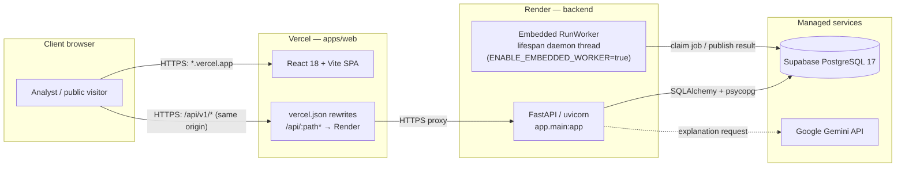

# Pax Virentia — Production Deployment Guide (Vercel + Render)

**Version:** 1.0 · 23 October 2026  
**Audience:** deployment operators, backend/frontend developers, and reviewers  
**Scope:** production deployment of the React/Vite frontend to Vercel and the FastAPI backend to
Render, with Supabase PostgreSQL and optional Google Gemini explanations.

This guide describes the approved two-platform topology. The backend is deployed **first** so its
public URL can be placed in the frontend's same-origin API rewrite. The rewrite is a routing
mechanism, not an authorization boundary: the API still enforces sessions, roles, origin checks,
and CSRF.

> **Do not commit secrets.** Environment values in this guide are placeholders. Keep
> `backend/.env` and platform environment variables out of git.

---

## 1. Production topology



| Layer | Platform | Notes |
| --- | --- | --- |
| Frontend | Vercel | Static Vite build from `apps/web`. SPA fallback plus `/api` proxy in `apps/web/vercel.json`. |
| Backend | Render Web Service | Root directory `backend`; `$PORT` supplied by Render. Runs bootstrap then uvicorn. |
| Worker | Embedded in the API by default | `RunWorker` starts as a daemon thread in the FastAPI lifespan. A separate worker process remains supported. |
| Database | Supabase PostgreSQL | See [§6.4](#64-supabase-connection-pooler-port-5432-vs-6543) before choosing a port. |
| AI | Google Gemini | Server-side only. Missing key or provider failure falls back to the deterministic explanation. |

### 1.1 Deployment sequence

1. Prepare the repository and verify local builds.
2. Deploy the Render backend and capture its `https://<service>.onrender.com` URL.
3. Verify the backend `/health` endpoint.
4. Set the Render URL in `apps/web/vercel.json`.
5. Deploy the Vercel frontend and capture its production URL.
6. Add the Vercel origin to Render's `ALLOWED_ORIGINS` and redeploy the backend.
7. Run the post-deployment smoke test.

Deploying the backend first avoids a frontend build that points at an unknown API host. The first
Vercel page load may show an origin error until step 6 is complete; that is expected.

---

## 2. Prerequisites

### 2.1 Accounts and services

- A GitHub repository containing this project, with permission to connect it to Render and Vercel.
- A [Render](https://render.com/) account. A free web service is sufficient for a demonstration;
  see the cold-start limitations in [§6.3](#63-render-cold-starts-and-the-free-tier).
- A [Vercel](https://vercel.com/) account.
- A Supabase project (PostgreSQL 17) or another PostgreSQL 17-compatible database.
- A Google AI Studio/Gemini API key if AI explanations are required. The application still works
  without one, using deterministic template explanations.
- The seed analyst credentials. The bootstrap script creates `SEED_USER_EMAIL` with
  `SEED_USER_PASSWORD`; change the development default before a real deployment.

### 2.2 Repository prerequisites

| Path | Purpose | Required |
| --- | --- | --- |
| `backend/requirements.txt` | Runtime dependencies installed by Render. If absent, Render can use `pip install .` with `pyproject.toml`, but the supported deployment command uses this file. | Yes for the documented build |
| `render.yaml` (repository root) | Optional Render Blueprint describing the web service and environment variables. | Optional |
| `apps/web/vercel.json` | Vercel rewrites: API proxy and SPA fallback. | Yes |
| `backend/app/main.py` | Exports the FastAPI object as `app` and supports the embedded worker when enabled. | Yes |
| `backend/app/config.py` | Reads the environment variables listed in [§4](#4-environment-variables-reference). | Yes |

### 2.3 Local pre-flight checks

Run these before pushing a deployment commit:

```bash
PYTHONPATH=backend python3 -m unittest discover -s backend/tests -p "test_*.py" -v
```

```bash
cd "apps/web"
npm ci
npm run build
npm run lint
```

A failing test, type-check, or production build should block deployment. Do not deploy a frontend
that cannot build locally.

---

## 3. Step-by-step deployment

### 3.1 Deploy the backend to Render

#### Option A — Blueprint from `render.yaml` (recommended)

1. Commit and push the deployment files to the branch you intend to deploy.
2. Open the [Render Dashboard](https://dashboard.render.com/) and choose **New + → Blueprint**.
3. Connect the GitHub repository and select the branch.
4. Render reads `render.yaml` from the repository root. Review the service and click **Apply**.
5. When Render prompts for variables marked `sync: false`, enter the database URL, Gemini key, and
   seed password. Values marked `generateValue: true` are generated by Render.
6. Wait for the build and the first deploy. The start command runs the idempotent bootstrap and then
   starts uvicorn.

Reference Blueprint:

```yaml
services:
  - type: web
    name: pax-virentia-api
    runtime: python
    plan: free
    region: singapore
    rootDir: backend
    buildCommand: pip install -r requirements.txt
    startCommand: python -m app.bootstrap && uvicorn app.main:app --host 0.0.0.0 --port $PORT
    healthCheckPath: /health
    envVars:
      - key: PYTHON_VERSION
        value: 3.11.9
      - key: DATABASE_URL
        sync: false
      - key: ALLOWED_ORIGINS
        value: '["http://localhost:5173", "https://pax-virentia.vercel.app"]'
      - key: SECRET_KEY
        generateValue: true
      - key: SESSION_LIFETIME_HOURS
        value: "24"
      - key: SESSION_REMEMBER_HOURS
        value: "720"
      - key: SUPABASE_URL
        sync: false
      - key: SUPABASE_ANON_KEY
        sync: false
      - key: SUPABASE_SERVICE_ROLE_KEY
        sync: false
      - key: GEMINI_API_KEY
        sync: false
      - key: GEMINI_MODEL
        value: gemini-3.5-flash
      - key: ENABLE_EMBEDDED_WORKER
        value: "true"
      - key: SEED_USER_EMAIL
        value: rivera.dev.miggy@gmail.com
      - key: SEED_USER_PASSWORD
        sync: false
      - key: SEED_USER_NAME
        value: Miggy
      - key: SEED_USER_ROLE
        value: analyst
```

> If the repository's `render.yaml` already exists, treat the snippet above as the expected shape
> rather than replacing unrelated settings blindly. Keep the approved region and plan for the
> project.

#### Option B — Manual Web Service

1. In the Render Dashboard choose **New + → Web Service** and connect the repository.
2. Configure:
   - **Name:** `pax-virentia-api` (or the project's approved name)
   - **Region:** Singapore (closest to the Supabase `ap-southeast-2` project)
   - **Branch:** the deployment branch
   - **Root Directory:** `backend`
   - **Runtime:** Python 3
   - **Build Command:** `pip install -r requirements.txt`
   - **Start Command:** `python -m app.bootstrap && uvicorn app.main:app --host 0.0.0.0 --port $PORT`
   - **Health Check Path:** `/health`
   - **Instance Type:** Free for a demo; a paid always-on instance for production
3. Add the environment variables from [§4.1](#41-render-backend) before the first deploy. Render
   supplies `PORT`; do not set it manually.
4. Click **Create Web Service**.

`app.main:app` is the FastAPI object exported by `backend/app/main.py`. The module also exports
`application = app`, so the approved `app.main:application` command is equivalent. If a fork exports
the object under a different name, update the start command to match.

#### What startup does

The start command is two steps joined by `&&`:

```text
python -m app.bootstrap
  → creates missing tables (idempotent DDL)
  → provisions the configured seed analyst and the sample analyst account
uvicorn app.main:app --host 0.0.0.0 --port $PORT
  → starts the API
  → starts the embedded worker thread when ENABLE_EMBEDDED_WORKER=true
```

Bootstrap is safe to re-run. It does not delete data and does not reset an account that already
exists; changing `SEED_USER_PASSWORD` after the first deploy does not change the stored password.
Because bootstrap runs on every deploy, the database URL must support the DDL and must remain
reachable during startup. See [§6.4](#64-supabase-connection-pooler-port-5432-vs-6543).

#### Obtain the live API URL

When the deploy reports **Live**, copy the service URL from the Render dashboard, for example:

```text
https://pax-virentia-api.onrender.com
```

Keep this URL; it is the rewrite destination in `apps/web/vercel.json`. Do not append `/api` to the
base URL when recording it.

#### Verify `/health`

```bash
curl -fsS https://pax-virentia-api.onrender.com/health
```

Expected response:

```json
{"status":"healthy","service":"Pax Virentia API","version":"0.1.0"}
```

If the first request times out on a free instance, see [§6.3](#63-render-cold-starts-and-the-free-tier).
Also verify OpenAPI:

```bash
curl -fsS https://pax-virentia-api.onrender.com/api/v1/openapi.json > /dev/null \
  && echo "OpenAPI reachable"
```

Check the Render logs for the bootstrap account lines and `Application startup complete`. Bootstrap
logs account creation but not passwords; still avoid copying environment values into tickets or
chat.

### 3.2 Configure the Vercel frontend

#### Set the API rewrite

Edit `apps/web/vercel.json` and replace the placeholder host with the Render URL captured in
§3.1:

```json
{
  "$schema": "https://openapi.vercel.sh/vercel.json",
  "rewrites": [
    {
      "source": "/api/:path*",
      "destination": "https://pax-virentia-api.onrender.com/api/:path*"
    },
    {
      "source": "/(.*)",
      "destination": "/index.html"
    }
  ]
}
```

Rules:

- The first rewrite makes every browser API call same-origin. The frontend calls `/api/v1/...`;
  Vercel forwards it to `https://<service>.onrender.com/api/v1/...`. The browser never sends a
  cross-site request to `onrender.com`, so the `__Host-pv_session` cookie is not treated as a
  third-party cookie.
- The second rewrite is the SPA fallback for React Router paths such as `/results` and
  `/public/reports/<slug>`. Vercel serves matching static files from `dist` before applying this
  rewrite.
- Do **not** point the rewrite at just the host root. The `/api/:path*` path must be preserved.
- Do **not** put the Render URL into a `VITE_*` variable for the browser. That reintroduces
  cross-origin requests and breaks the cookie flow.

If the Vercel project is configured with the repository root as its Root Directory instead of
`apps/web`, place the same `vercel.json` at the repository root and set the build/output paths
accordingly. The recommended setup is Root Directory `apps/web`.

#### Import and deploy the project

1. Commit and push the updated `apps/web/vercel.json`.
2. Open [Vercel](https://vercel.com/new) and choose **Add New… → Project**.
3. Import the GitHub repository.
4. Configure the project:
   - **Framework Preset:** Vite
   - **Root Directory:** `apps/web`
   - **Install Command:** `npm ci` (or the default `npm install` if the lockfile is intentionally
     absent)
   - **Build Command:** `npm run build`
   - **Output Directory:** `dist`
   - **Node.js Version:** 20 or newer
5. Add any public build variables from [§4.2](#42-vercel-frontend). No backend secret belongs here.
6. Click **Deploy**.
7. When the deployment succeeds, copy the production URL, for example
   `https://pax-virentia.vercel.app`.

Preview deployments receive different hostnames (for example
`https://pax-virentia-git-main-<team>.vercel.app`). Each browser origin must be trusted by the
backend separately, or matched by an approved wildcard.

### 3.3 Authorize the Vercel origin in Render

1. Open the Render service → **Environment**.
2. Set `ALLOWED_ORIGINS` to a JSON array containing every browser origin that may call the API:

   ```json
   [
     "https://pax-virentia.vercel.app",
     "https://pax-virentia-git-main-your-team.vercel.app",
     "http://localhost:5173",
     "http://localhost:5174",
     "http://127.0.0.1:5173"
   ]
   ```

   Origins have the form `scheme://host[:port]` with **no trailing slash and no path**.

3. Save and redeploy the backend so the new value is loaded.
4. Reload the Vercel site and sign in.

The backend supports exact origins plus one wildcard form: `https://*.vercel.app`. That pattern
matches HTTPS subdomains of `vercel.app`, including preview hostnames, but it does **not** support a
project-scoped pattern such as `https://pax-virentia-*.vercel.app`. Prefer exact production and
preview origins; use the wildcard only when preview convenience is worth trusting every matching
Vercel deployment as a CSRF origin. The backend also accepts a comma-separated list instead of JSON.

### 3.4 Verify the proxy end to end

The backend health endpoint is outside the `/api` rewrite, so it is verified directly on Render.
Use OpenAPI to verify the Vercel proxy path:

```bash
curl -fsS https://pax-virentia.vercel.app/api/v1/openapi.json > /dev/null \
  && echo "Vercel proxy reaches the API"
```

Optional session check with curl. Use the seed password, not a personal secret:

```bash
curl -i -c /tmp/pv-cookies.txt \
  -H "Origin: https://pax-virentia.vercel.app" \
  -H "Content-Type: application/json" \
  -d '{"email":"rivera.dev.miggy@gmail.com","password":"<SEED_USER_PASSWORD>","remember":false}' \
  https://pax-virentia.vercel.app/api/v1/auth/login
```

Expected: HTTP `200`, a JSON body containing `csrf_token`, and a response header like:

```http
Set-Cookie: __Host-pv_session=<opaque>; Max-Age=86400; Path=/; Secure; HttpOnly; SameSite=Lax
```

Then:

```bash
curl -fsS -b /tmp/pv-cookies.txt \
  https://pax-virentia.vercel.app/api/v1/auth/session
```

Delete the cookie jar when finished. Never paste real session cookies into tickets or logs.

---

## 4. Environment variables reference

`backend/app/config.py` loads `backend/.env` first, then a relative `.env`, using
`pydantic-settings` with `case_sensitive=True`. On Render, set these in the dashboard or Blueprint;
do not ship a production `.env` file.

### 4.1 Render backend

| Variable | Required | Example (placeholder) | Sensitivity | Purpose and notes |
| --- | --- | --- | --- | --- |
| `DATABASE_URL` | Yes | `postgresql+psycopg://postgres.<project-ref>:<url-encoded-password>@aws-0-<region>.pooler.supabase.com:5432/postgres?sslmode=require` | **Secret** | PostgreSQL/SQLite connection string. Production must use PostgreSQL. URL-encode `@`, `#`, `:`, `!`, `%` in the password. See [§6.4](#64-supabase-connection-pooler-port-5432-vs-6543). |
| `ALLOWED_ORIGINS` | Yes | `["https://pax-virentia.vercel.app","http://localhost:5173"]` | Config | JSON array (or comma-separated list) of browser origins accepted for CORS **and** the API's origin/CSRF check. No path or query. Exact origins are preferred; the only wildcard form supported is `https://*.vercel.app`. |
| `SECRET_KEY` | Yes | Render-generated 32+ character random value | **Secret** | Application security key. Render's `generateValue: true` is preferred. Never reuse the development placeholder. |
| `ENABLE_EMBEDDED_WORKER` | Yes | `true` | Config | Starts `RunWorker` in the FastAPI lifespan. Set `false` only when a separate worker process or Render Background Worker is deployed. |
| `GEMINI_API_KEY` | For AI | `AIza...` (issued key, never the plan's example) | **Secret** | Server-side Gemini key. Leave empty to use deterministic explanations. Never expose through Vercel or `VITE_*`. |
| `GEMINI_MODEL` | Recommended | `gemini-3.5-flash` | Config | Pinned explanation model. Confirm the model is available to the project; `3.8` may be rate-limited or unavailable. The API falls back to a template on failure. |
| `SESSION_LIFETIME_HOURS` | No | `24` | Config | Standard session lifetime. |
| `SESSION_REMEMBER_HOURS` | No | `720` | Config | Lifetime when "remember me" is selected. |
| `SEED_USER_EMAIL` | Recommended | `rivera.dev.miggy@gmail.com` | Config | Analyst created during bootstrap. Use an operational mailbox in real deployments. |
| `SEED_USER_PASSWORD` | Recommended | a unique strong password | **Secret** | Password used only when bootstrap first creates the seed account. The development default is public knowledge; set it before the first deploy. Re-running bootstrap does not reset an existing password. |
| `SEED_USER_NAME` | No | `Miggy` | Config | Display name for the seed analyst. |
| `SEED_USER_ROLE` | No | `analyst` | Config | Seed role. Keep least privilege; do not seed `administrator` unless required. |
| `SUPABASE_URL` | No | `https://<project-ref>.supabase.co` | Config | Reserved project URL. The current backend does not call the Supabase REST API. |
| `SUPABASE_ANON_KEY` | No | placeholder | Public-ish but unnecessary | Reserved. Do not use it as a substitute for backend authorization. |
| `SUPABASE_SERVICE_ROLE_KEY` | No | placeholder | **Secret** | Reserved server-side key. Never expose it to the browser or commit it. |
| `PROJECT_NAME` | No | `Pax Virentia API` | Config | OpenAPI title. |
| `VERSION` | No | `0.1.0` | Config | Application version shown in `/health` and OpenAPI. |
| `API_V1_STR` | No | `/api/v1` | Config | API prefix. Change only with a matching frontend and rewrite update. |
| `CODE_VERSION` | Recommended | short git SHA or release tag | Config | Frozen into runs for provenance. Set it to the deployed commit, not `0.1.0-dev`. |
| `PYTHON_VERSION` | Build-time | `3.11.9` | Config | Render build setting. The project requires Python 3.11 or newer. |

> **Secrets already in a planning document are compromised.** If a real database password, Gemini
> key, or seed password was ever pasted into a document, chat, or commit, rotate it in Supabase or
> Google AI Studio and redeploy. This guide deliberately uses placeholders only.

### 4.2 Vercel frontend

| Variable | Required | Example | Sensitivity | Purpose and notes |
| --- | --- | --- | --- | --- |
| `VITE_API_BASE_URL` | No | `/api/v1` | Public | Optional public API base if the frontend build supports it. Keep it relative for the same-origin proxy. Pointing it at `https://<service>.onrender.com/api/v1` breaks the cookie model. |
| Any other `VITE_*` value | No | non-secret build metadata | **Public** | Vite embeds `VITE_*` values in the browser bundle. Never put `GEMINI_API_KEY`, `DATABASE_URL`, `SECRET_KEY`, Supabase service-role keys, or session secrets here. |

The current `apps/web/src/services/api.ts` calls the relative `/api/v1` path directly. If the
optional base variable is not implemented in the deployed revision, do not set it; the relative
path is already correct for this topology.

### 4.3 Platform build settings (not application variables)

| Platform | Setting | Value |
| --- | --- | --- |
| Render | Root Directory | `backend` |
| Render | Build Command | `pip install -r requirements.txt` |
| Render | Start Command | `python -m app.bootstrap && uvicorn app.main:app --host 0.0.0.0 --port $PORT` |
| Render | Health Check Path | `/health` |
| Vercel | Root Directory | `apps/web` |
| Vercel | Framework Preset | Vite |
| Vercel | Build Command | `npm run build` |
| Vercel | Output Directory | `dist` |
| Vercel | Node.js | 20 or newer |

---

## 5. Post-deployment smoke test

Perform this after the backend and frontend are both live and `ALLOWED_ORIGINS` contains the
Vercel origin. Record the date, deployment IDs, run ID, and public report slug with the result.

### 5.1 Backend health and proxy

| Check | Action | Expected |
| --- | --- | --- |
| Render health | `curl -fsS https://<service>.onrender.com/health` | `{"status":"healthy",...}` |
| Render OpenAPI | `curl -fsS https://<service>.onrender.com/api/v1/openapi.json` | JSON document |
| Vercel proxy | `curl -fsS https://<app>.vercel.app/api/v1/openapi.json` | Same JSON via Vercel |
| SPA fallback | Open `https://<app>.vercel.app/results` directly | The app shell loads; no Vercel `404` |

### 5.2 Analyst login

1. Open `https://<app>.vercel.app/login`.
2. Sign in with `SEED_USER_EMAIL` and `SEED_USER_PASSWORD` configured on Render. Bootstrap also
   creates `ana.santos@example.com` with the development default password; treat that account as a
   demo convenience, not a production identity.
3. Confirm the dashboard loads and the browser has a `__Host-pv_session` cookie under the Vercel
   host. In browser devtools, check **Application → Cookies**; the value is opaque and must not be
   copied into a report.
4. Confirm `GET /api/v1/auth/session` returns the analyst and role in the network panel.

If login returns `403 origin_rejected`, fix `ALLOWED_ORIGINS` before continuing. If login returns
`200` but the next request is `401`, see [§6.2](#62-login-succeeds-but-the-session-is-lost).

### 5.3 Create a scenario

Use the UI at **Scenarios → Create scenario**. A valid sample value set for a smoke test:

| Field | Sample value |
| --- | --- |
| Scenario name | `Production smoke baseline` |
| Scenario type | Baseline |
| Treatment specification | Pax Silica Advanced Coagulation & Filtration (`pax-silica-v1`) |
| Reporting period | `2024-01-01 00:00` to `2024-01-05 23:59` (Asia/Manila) |
| Treated volume | `3000` m³ |
| Flow rate | `150` m³/h |
| Pump duty | `20` h |
| Mixing hours | `4` h |
| Mixing load | `0.8` |
| Chemical dose | `30` mg/L |
| Electricity tariff | `11` PHP/kWh |
| Chemical price | `50` PHP/kg |
| Labor | `40000` PHP |
| Maintenance | `15000` PHP |
| Other non-energy | `12000` PHP |
| Cost source | `Analyst-entered smoke-test assumptions` |
| Emission factor | Luzon-Visayas Grid Average 2024 (`ph-luzon-2024`) |

The period must fit the factor's reporting year. If the catalog serves a different year, choose a
period inside that year rather than mixing versions. Leave the dataset UUID empty for this smoke
test.

Click through **Operating conditions → Costs and emissions → Review and run**.

### 5.4 Run the simulation with the embedded worker

1. On the review step, click **Run simulation**.
2. Confirm the progress dialog moves from `queued` to `running` to `succeeded`.
3. On a warm instance the run typically completes in a few seconds. Allow up to a minute for a
   cold Render instance or a busy free-tier CPU.
4. If it stays `queued`:
   - Confirm `ENABLE_EMBEDDED_WORKER=true` in Render and that the deploy that set it is live.
   - Confirm the Render logs show no worker-thread import or database error.
   - If embedded mode is intentionally disabled, confirm a separate worker is running.
   - See [§6.3](#63-render-cold-starts-and-the-free-tier) and [§6.4](#64-supabase-connection-pooler-port-5432-vs-6543).

The run freezes the scenario revision and evidence versions. Re-running does not mutate the old
run. The embedded worker claims the durable job with a lease; a separate worker, if used, runs the
same `RunWorker` code.

### 5.5 Dynamic results

1. Open **Results** (the success dialog also links to the run).
2. Confirm the page shows values, not a loading placeholder, for:
   - Energy consumption in `kWh` and energy intensity in `kWh/m³`
   - Electricity-associated emissions in `kg CO2e` (the sample factor is `CO2e`)
   - Operating cost and cost intensity in `PHP` and `PHP/m³`
3. Confirm **Downstream ecosystem stress** is `not_estimable`, with a reason and required evidence.
   `not_estimable` must not be displayed as zero.
4. Switch to **Inputs and provenance** and confirm the frozen technology, factor, period, and
   limitations are present.

Sample arithmetic for the smoke inputs (illustrative; the API is authoritative): pump energy
`22 kW × 20 h = 440 kWh`; mixer energy `7.5 kW × 0.8 × 4 h = 24 kWh`; total `464 kWh`. Emissions
`464 × 0.7122 ≈ 330.5 kg CO2e`. OPEX includes `464 × 11 = 5,104 PHP` electricity, `90 kg × 50 =
4,500 PHP` chemical, and `67,000 PHP` labor/maintenance/other, for `76,604 PHP`.

### 5.6 Gemini explanation

1. On the same Results page, click **Explain these results**.
2. Confirm a narrative appears with key findings and limitations.
3. Inspect the network response for the explanation request:
   - `grounded_evidence.source = "gemini"` means the provider output passed grounding validation.
   - `grounded_evidence.source = "deterministic_fallback"` with a `fallback_reason` means the
     narrative is the safe template. The numerical results are still valid.
4. Confirm the narrative does not invent numbers or replace the stored metrics with prose.

If the key is missing or the provider is unavailable, the fallback is the expected behavior, not a
failed deployment. See [§6.7](#67-ai-explanations-fail-or-always-use-the-template).

### 5.7 Publish a public report

1. In the **Publish report** card on the Results page, optionally enter a public summary.
2. Click **Publish report**.
3. Confirm the success message includes a slug and a **View public report** link.
4. Open the link. The public path is `/public/reports/<slug>`; the API path is
   `/api/v1/public/reports/<slug>`.
5. Open the same URL in a private/incognito window. It must load without a session and without
   exposing drafts, raw uploads, internal notes, or unpublished runs.
6. Confirm the public snapshot includes limitations and shows `not_estimable` ecology as such.

Publication is a reviewed snapshot, not regulatory approval. Withdraw or fix misleading public
content through the approved process for the deployed revision.

### 5.8 Sign-out and session hygiene

1. Use the **Sign out** control in the workspace header.
2. Confirm `/api/v1/auth/session` returns `401` and the cookie is cleared.
3. Confirm the browser cannot reach private routes after sign-out.

### 5.9 Smoke-test record

| Item | Result |
| --- | --- |
| Deployment timestamp and operator | |
| Render deploy ID / commit SHA | |
| Vercel deployment ID / commit SHA | |
| Health and proxy checks | Pass / fail |
| Analyst login and session | Pass / fail |
| Scenario revision ID | |
| Run ID and status | |
| Dynamic results verified | Pass / fail |
| Explanation source (`gemini` / `deterministic_fallback`) | |
| Public report slug and unauthenticated check | Pass / fail |
| Sign-out check | Pass / fail |
| Notes / follow-up owner | |

---

## 6. Troubleshooting common cloud issues

### 6.1 CORS and `origin_rejected` / `csrf_rejected`

**Symptoms**

- Login returns `403 origin_rejected`.
- A mutation returns `403 csrf_rejected`.
- Browser console shows a CORS error, or the network panel shows a blocked preflight.

**Cause**

The API's `require_trusted_origin` and `require_analyst` compare the request's `Origin` header
against `ALLOWED_ORIGINS` exactly. CORS middleware alone does not satisfy this check. Because the
frontend normally calls the same-origin Vercel proxy, the browser usually will not show a classic
CORS failure; the request reaches Render and is rejected by the origin/CSRF guard instead.

**Fix**

1. Read the exact browser origin from devtools: scheme, host, and port. Do not include a trailing
   slash, path, or wildcard in an exact entry.
2. Add that origin to `ALLOWED_ORIGINS` as a JSON array string, for example:

   ```json
   ["https://pax-virentia.vercel.app","https://pax-virentia-git-main-your-team.vercel.app","http://localhost:5173"]
   ```

3. Redeploy the Render service so the environment value is reloaded.
4. For preview deployments, add each preview origin. If preview convenience justifies the broader
   trust, add `https://*.vercel.app`; project-scoped wildcard patterns are not supported.
5. Retry login in a fresh tab. If the cookie is stale, clear the site's cookies and sign in again.
6. Test the origin directly:

   ```bash
   curl -i -H "Origin: https://pax-virentia.vercel.app" \
     -H "Content-Type: application/json" \
     -d '{"email":"rivera.dev.miggy@gmail.com","password":"<SEED_USER_PASSWORD>"}' \
     https://pax-virentia-api.onrender.com/api/v1/auth/login
   ```

Do not "fix" the issue by setting `ALLOWED_ORIGINS` to `*`, by disabling the origin check, or by
sending credentials with wildcard CORS. The API uses credentialed requests; a wildcard is both
invalid for that mode and unsafe.

### 6.2 Login succeeds but the session is lost

**Symptoms**

- Login returns `200` with a CSRF token.
- The next request is `401 authentication_required`.
- No `__Host-pv_session` cookie appears in devtools.
- Works locally but fails in production.

**Cause and fix**

| Cause | Check | Fix |
| --- | --- | --- |
| Browser called Render directly instead of the Vercel proxy | The login request URL is `*.onrender.com` instead of `*.vercel.app/api/...` | Use the relative `/api/v1` client path and the `vercel.json` rewrite. Do not set a cross-origin production API base. |
| The `__Host-` cookie was rejected | Cookie is absent after a `200`; response header is present | `__Host-` requires HTTPS, `Path=/`, `Secure`, and **no** `Domain` attribute. Keep the backend cookie settings intact. Do not rename or add a Domain. |
| Third-party cookie blocking | Request is cross-site (`app.vercel.app` → `api.onrender.com`) | Make requests same-origin through the proxy. `SameSite=Lax` is correct for the proxied same-site flow. Do not switch to `SameSite=None` as a substitute for the proxy. |
| Proxy does not forward `Set-Cookie` | Render response has `Set-Cookie`; browser response does not | Verify the Vercel rewrite is an external proxy rewrite and that no response header stripping is in place. |
| Plain HTTP or an IP-based local test | URL is `http://` in production | Use HTTPS. `__Host-` cookies are Secure-only by definition. |
| Cookie was cleared between login and the next call | React state has a user but sessionStorage lost the CSRF token | Reload once and sign in again. CSRF tokens are held in `sessionStorage`; an incognito window or storage clear drops them. |

Verify the response header:

```bash
curl -i -c /tmp/pv-cookies.txt \
  -H "Origin: https://pax-virentia.vercel.app" \
  -H "Content-Type: application/json" \
  -d '{"email":"rivera.dev.miggy@gmail.com","password":"<SEED_USER_PASSWORD>"}' \
  https://pax-virentia.vercel.app/api/v1/auth/login
```

Look for exactly one `__Host-pv_session` `Set-Cookie` with `Secure`, `HttpOnly`, `SameSite=Lax`,
`Path=/`, and no `Domain`.

### 6.3 Render cold starts and the free tier

**Symptoms**

- The first request after idle takes 30–60 seconds or times out.
- `/health` is slow but eventually returns `healthy`.
- A run stays `queued` after the browser tab is closed.
- The worker appears to stop overnight.

**Cause**

Render free web services spin down after a period of inactivity (typically 15 minutes). The next
request starts the container, which rebuilds the process, loads the app, and starts the embedded
worker. During that window the service is unavailable or slow. When the service sleeps, the
embedded worker sleeps too; queued jobs resume only when the service wakes.

**Operational rules**

- Treat a single slow first request as a cold start, not a failed deploy. Retry once and check
  `/health`.
- Keep the sign-in flow patient: a 30–60 second wait is normal on a cold free instance.
- If a run was queued and the tab was closed, reopen the app or `/health` to wake the service; the
  worker then claims the job.
- For a production service with run-completion guarantees, use a paid always-on Render instance.
  A separate worker on a paid instance is the stronger option; see [§7](#7-worker-modes-and-operations).
- A periodic ping may reduce demo cold starts, but it consumes instance hours, is not a monitoring
  contract, and does not make the free tier an always-on production service.

**Do not** increase the database pool, add retries inside the worker loop, or disable lease
renewal to compensate for cold starts. Those changes hide lifecycle problems and can cause
duplicate or stalled work.

### 6.4 Supabase connection pooler: port 5432 vs 6543

Supabase exposes several connection paths. They are not interchangeable for every workload.

| Mode | Typical port | Behaviour | Use here |
| --- | --- | --- | --- |
| Direct connection | 5432 on `db.<ref>.supabase.co` | One backend connection per client connection; full session state; DDL and prepared statements work. May be IPv6-only or require the project's IPv4 add-on depending on network. | Fine for local/bootstrap when reachable from Render. |
| Session pooler (Supavisor) | **5432** on `aws-0-<region>.pooler.supabase.com` | Pooled, but a client keeps a session for its lifetime; supports session state, DDL, and prepared statements. Username is usually `postgres.<project-ref>`. | **Recommended for this deployment**, because every Render start runs bootstrap DDL. |
| Transaction pooler | **6543** on the same pooler host | A server connection is assigned per transaction; no session state across transactions; DDL and prepared statements are restricted. | Suitable for some stateless/serverless workloads, but not the simplest fit for this app's long-lived SQLAlchemy pool and startup bootstrap. |

The application opens a SQLAlchemy pool with `pool_size=5, max_overflow=0` per process. In embedded
worker mode, the API and worker share that process and pool. Multiple Render instances multiply
the connection count; keep the total below the Supabase plan's connection limit.

**Configuration example (session pooler, 5432):**

```env
DATABASE_URL="postgresql+psycopg://postgres.<project-ref>:<url-encoded-password>@aws-0-<region>.pooler.supabase.com:5432/postgres?sslmode=require"
```

**If you choose the transaction pooler (6543):**

- Bootstrap DDL runs on every start; verify it succeeds. If it fails, move bootstrap to a one-off
  step using the 5432 session connection, or keep the runtime URL on 5432.
- If you see errors about prepared statements or missing server-side state, use 5432 or configure
  the driver to avoid prepared statements. Do not add retries around DDL as a workaround.
- Transaction pooling does not preserve session-level settings across statements.

**Common database failures**

| Symptom | Cause | Fix |
| --- | --- | --- |
| `could not translate host name` / timeout | Direct hostname not reachable from Render, or wrong region | Use the Supabase pooler hostname for the project's region. |
| `password authentication failed` | Special characters not URL-encoded, wrong project ref, or wrong pooler username | URL-encode the password; use `postgres.<project-ref>` for the pooler. Rotate the password if it was exposed. |
| `SSL required` / connection closed | Missing `?sslmode=require` | Append `?sslmode=require`. |
| Bootstrap fails but API can start | DDL restricted through 6543 | Bootstrap with the 5432 session/direct connection. |
| Too many connections | Multiple Render instances × pool size, or other clients | Reduce instances/pool size or use the pooler; confirm Supabase limits. |
| Project paused | Free Supabase projects can pause after inactivity | Resume the project in Supabase, then retry. |

### 6.5 Render build and start failures

| Symptom | Likely cause | Resolution |
| --- | --- | --- |
| `requirements.txt not found` | Wrong Root Directory or missing file | Set Root Directory to `backend`; confirm the file is on the deployed branch. |
| `ModuleNotFoundError: app` | Start command run from the wrong directory | Keep Root Directory `backend`; use `python -m app.bootstrap` and `uvicorn app.main:app` there. |
| Build installs a different Python version | `PYTHON_VERSION` unset or unavailable | Set `PYTHON_VERSION=3.11.9` (or a supported 3.11+ version) and redeploy. |
| Port binding error | Start command hard-codes a local port | Use `--port $PORT`; Render injects the port. |
| Deploy succeeds but service is unhealthy | Bootstrap failing, wrong DATABASE_URL, or missing dependency | Read the deploy logs around bootstrap; fix the database connection first. |
| Static frontend gets `404` on refresh | Missing SPA fallback rewrite | Add `/(.*)` → `/index.html` after the `/api` rewrite. |
| Frontend build fails on `tsc` | Type error in the deployed commit | Run `npm run build` locally and fix before deploying; do not skip type-checking in production. |

### 6.6 Vercel rewrite and environment problems

| Symptom | Likely cause | Resolution |
| --- | --- | --- |
| `/api/v1/...` returns Vercel `404` | Rewrite missing, typo in `:path*`, or config outside the project root | Confirm `apps/web/vercel.json` is in the Vercel Root Directory and the source is `/api/:path*`. |
| API requests go to the wrong host | Stale rewrite destination or an old deployment | Update the destination to the current Render URL and redeploy. |
| Environment change has no effect | Vite variables are build-time; a saved variable needs a new deployment | Redeploy the Vercel project after changing build variables. |
| Secrets appear in the bundle | A backend secret was prefixed `VITE_` | Remove it, rotate the secret, and redeploy. |
| Preview works but production does not | Origin allowlist has only the preview host | Add the production origin to `ALLOWED_ORIGINS` on Render. |

### 6.7 AI explanations fail or always use the template

| Symptom | Likely cause | Resolution |
| --- | --- | --- |
| Explanation returns `deterministic_fallback` with `missing_api_key` | `GEMINI_API_KEY` unset on Render | Set the key on the backend service and redeploy. |
| `provider_unavailable` | Wrong key, quota, regional outage, unsupported model, or timeout | Check the key and `GEMINI_MODEL`; try the pinned model; inspect Render logs (the API does not log provider payloads). |
| `grounding_rejected` | Provider output added or changed facts, numbers, or caveats | Expected fail-closed behavior. Keep the deterministic explanation; do not weaken validation. |
| Model returns `400 INVALID_ARGUMENT` | Unsupported schema or model capability | Use the pinned compatible model and current `google-genai` version; verify the schema sanitization is present in the deployed backend. |
| Explanations work but numbers look wrong | Narrative is not the source of truth | Read numeric metrics from the stored results; explanations only restate approved clauses. |

### 6.8 Health is fine but the UI cannot reach the API

Check, in order:

1. `curl -fsS https://<app>.vercel.app/api/v1/openapi.json`
2. Browser devtools → Network → the failing request's full URL and status.
3. Render logs correlated by `X-Request-ID`.
4. `ALLOWED_ORIGINS` and a redeploy.
5. Whether a Vercel preview origin differs from the production origin.

A `502` from Vercel usually means the Render service is asleep, starting, or crashed; check Render
first. A `403` almost always means origin/CSRF, not a network failure.

---

## 7. Worker modes and operations

### 7.1 Embedded worker (default deployment)

When `ENABLE_EMBEDDED_WORKER=true`, the FastAPI lifespan starts a daemon thread:

- It owns a `RunWorker` backed by the same repository/engine as the API.
- It loops: claim one ready job, renew the lease every 20 seconds, compute the frozen snapshot,
  publish results with a lease-fenced write, then immediately look for another job. When idle it
  waits about two seconds.
- On shutdown it sets a stop event. In-flight work is at-least-once; lease fencing prevents a stale
  attempt from publishing.
- It disappears when the Render instance sleeps, restarts, or deploys. Queued work resumes when the
  service starts again.

This is the cost-effective choice for a single-instance demo or small deployment. It competes with
the API for CPU and memory and cannot be scaled independently.

### 7.2 Separate worker process

Set `ENABLE_EMBEDDED_WORKER=false` on the API service, then run the worker as its own process:

```bash
cd "backend"
PYTHONPATH=. python3 -m app.jobs.worker
```

On Render this is a **Background Worker** service (a paid service type), with:

- Root Directory: `backend`
- Build Command: `pip install -r requirements.txt`
- Start Command: `python -m app.jobs.worker`

Both modes use the same `RunWorker` class and the same durable job table. Leases and fencing make
multiple workers safe from duplicate publication; they do not guarantee single execution. Choose
the separate process when you need independent restarts, scaling, or run completion while the web
service sleeps.

### 7.3 Routine operations

| Task | Procedure |
| --- | --- |
| Deploy a backend change | Push to the connected branch; Render rebuilds and reruns bootstrap. Watch logs through `Application startup complete`. |
| Deploy a frontend change | Push to the connected branch; Vercel builds. Verify the proxy and smoke test. |
| Rotate the Gemini key | Update Render `GEMINI_API_KEY`; redeploy; request an explanation and check the source. |
| Rotate the database password | Rotate in Supabase, update `DATABASE_URL` on Render, redeploy, and re-run health/login. |
| Roll back | Use Render's previous deploy and Vercel's instant rollback. Roll back the frontend and backend in a compatible pair; database changes must remain backward compatible. |
| Change the database schema | Do not rely on bootstrap for destructive changes. Apply a reviewed migration, then deploy code that tolerates both old and new columns during the transition. |
| Monitor | Use Render logs and health checks; Vercel deployment logs for build/runtime proxy issues. Include the API `X-Request-ID` in incident notes. |
| Back up | Use Supabase backups/PITR according to the project plan. Bootstrap is not a backup. |

---

## 8. Security checklist

- [ ] `SECRET_KEY` is generated and unique; the development default is not deployed.
- [ ] `SEED_USER_PASSWORD` is unique, or the default seed account was rotated after provisioning.
- [ ] `DATABASE_URL` and `GEMINI_API_KEY` exist only in Render's environment, never in git, Vercel,
      `VITE_*`, logs, or screenshots.
- [ ] No real credential remains in planning documents or previous messages; rotate if exposed.
- [ ] `ALLOWED_ORIGINS` contains only approved exact origins, or the supported
      `https://*.vercel.app` wildcard with its broader trust documented.
- [ ] The frontend uses the same-origin `/api/v1` proxy; no direct browser-to-Render API base.
- [ ] HTTPS is enforced on both hosts.
- [ ] Public report pages expose only published, redacted snapshots.
- [ ] Anyone with deployment access can rotate the database and Gemini credentials.
- [ ] Supabase connection limits are respected across all Render instances.
- [ ] Logs do not contain passwords, cookies, CSRF tokens, connection strings, or provider payloads.

---

## 9. Related documents

- [System Guide](SYSTEM_GUIDE.md) — architecture, calculation model, and operating guidance.
- [API Contracts](API_CONTRACTS.md) — endpoint schemas, headers, errors, and status codes.
- [Deployment Plan](DEPLOYMENT_PLAN.md) — the approved Vercel/Render plan and its technical
  enablers.
- [Render Web Services documentation](https://render.com/docs/web-services)
- [Render Blueprint specification](https://render.com/docs/blueprint-spec)
- [Vercel rewrite configuration](https://vercel.com/docs/rewrites)
- [Vercel Vite framework guide](https://vercel.com/docs/frameworks/vite)
- [Supabase connection guide](https://supabase.com/docs/guides/database/connecting-to-postgres)
- [MDN: Set-Cookie](https://developer.mozilla.org/en-US/docs/Web/HTTP/Headers/Set-Cookie)
- [MDN: third-party cookies](https://developer.mozilla.org/en-US/docs/Web/Privacy/Third-party_cookies)
