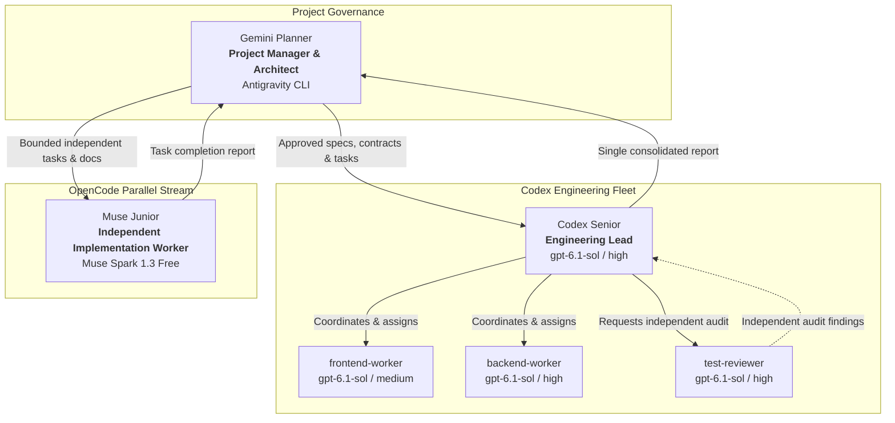

# Pax Virentia — Team Configuration & Operational Setup

**Version:** 1.0  
**Date:** 10 October 2026  
**Status:** Active operational configuration  
**Governing Documents:** [AGENTS.md](../AGENTS.md), [CONTEXT.md](../CONTEXT.md), [Pax-Virentia-System-Design.md](../Pax-Virentia-System-Design.md), [Branding.md](../Branding.md)

---

## 1. Overview & Organizational Hierarchy

Pax Virentia employs a coordinated multi-agent engineering workflow designed to enforce strict separation of concerns, contract-first development, and independent scientific verification.



---

## 2. Agent Roles, Models & Reasoning Configurations

| Agent | Platform / CLI | Model Identifier | Reasoning Level | Primary Domain & Responsibilities |
| :--- | :--- | :--- | :--- | :--- |
| **Gemini Planner** *(This session)* | Antigravity CLI | Gemini 3.8 Flash | High | **Project Manager & Overall Architect**<br>• Owns project scope, architecture, and specifications.<br>• Defines and approves API contracts and data models.<br>• Manages task dependencies and provides final acceptance. |
| **Codex Senior** | Codex CLI | `gpt-6.1-sol` | High | **Engineering Lead & Subagent Coordinator**<br>• Coordinates assigned Codex implementation and integration.<br>• Enforces contract agreements before related work begins.<br>• Integrates branches and delivers one consolidated report to Gemini Planner. |
| ↳ **`frontend-worker`** | Codex Subagent | `gpt-6.1-sol` | Medium | **Frontend UI & Visual Interactions**<br>• Scope: `apps/web/`<br>• Owns UI layout, forms, ECharts visualizations, responsiveness, and accessibility.<br>• Follows `Branding.md` design tokens strictly. |
| ↳ **`backend-worker`** | Codex Subagent | `gpt-6.1-sol` | High | **Backend Services & Persistence**<br>• Scope: `backend/`<br>• Owns FastAPI endpoints, database schemas, SQLAlchemy/Alembic, and simulation services.<br>• Preserves pure calculation modules and physical bounds. |
| ↳ **`test-reviewer`** | Codex Subagent | `gpt-6.1-sol` | High | **Independent QA & Verification**<br>• Scope: Read-only inspection / audit across project.<br>• Verifies mathematical correctness, security boundaries, and test coverage.<br>• Does **not** edit application code unless explicitly assigned. |
| **Muse Junior** | OpenCode CLI | `Muse Spark 1.3 Free`<br>*(contributor-free)* | High (xhigh) | **Separate OpenCode Implementation Worker**<br>• Direct worker under Gemini Planner (not a Codex subagent).<br>• Handles bounded independent tasks, mock fixtures, and documentation. |

---

## 3. Configuration & Definition Files

The project stores persistent configuration files defining this setup:

1. **[`.codex/config.toml`](../.codex/config.toml)**
   * Configures Codex Senior defaults:
     ```toml
     model = "gpt-6.1-sol"
     model_reasoning_effort = "high"

     [agents]
     enabled = true
     max_concurrent_threads_per_session = 3
     default_subagent_model = "gpt-6.1-sol"
     default_subagent_reasoning_effort = "high"
     ```

2. **[`.codex/agents/`](../.codex/agents/)**
   * Dedicated TOML profiles for each Codex subagent:
     * `frontend-worker.toml`: `gpt-6.1-sol` / `medium` reasoning.
     * `backend-worker.toml`: `gpt-6.1-sol` / `high` reasoning.
     * `test-reviewer.toml`: `gpt-6.1-sol` / `high` reasoning (read-only audit mandate).

3. **[`AGENTS.md`](../AGENTS.md)**
   * Project-level coordination instructions defining delegation rules, concurrency caps (max 3 open subagents), and reporting standards.

---

## 4. Coordination & Delegation Protocols

1. **Contract First**:
   * Before any frontend/backend integration begins, Gemini Planner and Codex Senior agree on the explicit API contract (endpoints, schemas, units, error statuses, loading/empty states).
   * Contract changes must route through Codex Senior and Gemini Planner.
2. **Explicit Non-Overlapping File Ownership**:
   * Every assigned task carries an explicit, non-overlapping file list.
   * Default folder boundaries (`apps/web/` vs `backend/`) are guidance; exact file lists are assigned per workstream.
   * Shared files (dependency manifests, lockfiles, shared contracts, configuration) are serialized under a single owner.
3. **Independent Review Gate**:
   * After implementation and integration, `test-reviewer` independently audits code and runs test suites.
   * Findings are addressed within assigned ownership and re-reviewed before declaring work complete.
4. **Consolidated Reporting**:
   * Subagents report solely to Codex Senior.
   * Codex Senior delivers **one consolidated report** to Gemini Planner containing:
     * Files modified and owners.
     * Contract decisions.
     * Test and validation results.
     * Independent review findings and disposition.
     * Any remaining blockers.
5. **Scientific Integrity Invariants**:
   * Pure Python calculation routines remain deterministic and isolated from HTTP/database layers.
   * Missing empirical evidence strictly yields status `not_estimable` (distinct from $0$ or software error).
   * AI (Google Gemini) generates narrative explanations only; it never invents numbers or overrides numerical models.

---

## 5. Runtime Environment & Tooling

* **Workspace Root:** `/mnt/c/Users/Miggy/Documents/Pax Virentia`
* **Git Repository:** Branch `main` on `https://github.com/migsrvr/Pax-Virentia.git`
* **Agent Manager MCP Server:**
  * Coordinates real CLI processes running in managed `tmux` sessions:
    * `Gemini Planner`: Session ID `3dfafd4b` (Antigravity CLI)
    * `codex-senior`: Session ID `1229b96c` (Codex CLI)
    * `muse-junior`: Session ID `60ed0c5b` (OpenCode CLI)
  * Communication tools: `send_session`, `read_session`, `wait_for_session`, `list_sessions`.
